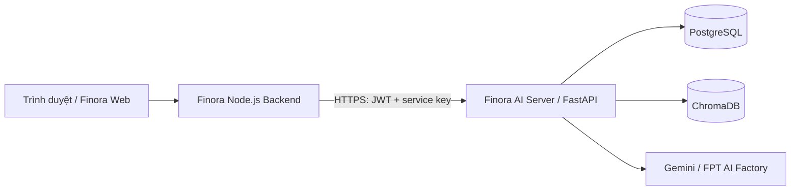

# Finora AI Business Advisor

Backend AI của Finora, hỗ trợ chủ shop theo dõi hoạt động kinh doanh, hiểu số liệu và tham khảo hướng cải thiện bán hàng. Dự án cung cấp API để phân tích dữ liệu thương mại điện tử, tạo insight, trả lời câu hỏi theo dữ liệu cửa hàng và hướng dẫn khách chưa đăng nhập tìm hiểu hệ thống.

Ứng dụng được xây dựng bằng **Python, FastAPI, SQLAlchemy, LangChain và ChromaDB**, hỗ trợ Gemini và FPT AI Factory. Website Finora và backend Node.js quản lý giao diện, tài khoản, shop, gói dịch vụ và thanh toán; repository này cung cấp dịch vụ AI để tích hợp vào hệ thống đó.

## Chức năng chính

- **Nhập dữ liệu bán hàng:** nhận file CSV/XLSX từ Shopee, TikTok Shop và Lazada, chuẩn hóa đơn hàng và sản phẩm theo từng tenant/shop.
- **Phân tích cửa hàng:** tổng quan doanh thu, đơn hàng, giá trị đơn trung bình; đánh giá sức khỏe kinh doanh, phí và các khoản thất thoát doanh thu.
- **Phân tích sản phẩm:** tra cứu SKU, đánh giá hiệu quả sản phẩm và đề xuất hành động.
- **Xu hướng thị trường:** nhận JSON từ backend web để tổng hợp bằng chứng và diễn giải xu hướng sản phẩm; không tự thu thập dữ liệu từ các sàn.
- **AI Business Insights:** phát hiện điểm cần chú ý từ chỉ số, tạo insight kèm bằng chứng và quản lý trạng thái `new`, `read`, `dismissed`.
- **Chatbot:** tách riêng chat dữ liệu shop, trải nghiệm bằng dữ liệu Demo Store và hướng dẫn thông tin hệ thống/tài khoản.
- **RAG và kế hoạch:** truy xuất tài liệu public/private, hỗ trợ tư vấn, kế hoạch bán hàng và truyền thông.

Các chỉ số kinh doanh được tính bằng code; LLM hỗ trợ diễn giải và tư vấn. Những đề xuất trong chat hoặc kế hoạch không tự thay đổi giá, ngân sách quảng cáo, voucher, listing hay tồn kho.

## Kiến trúc tích hợp



Backend web xác thực người dùng rồi gọi AI Server bằng thông tin định danh đã ký. Tenant/shop được lấy từ JWT, không lấy từ JSON do trình duyệt gửi. Service key và API key của provider chỉ lưu phía server.

## Cài đặt và chạy local

### 1. Chuẩn bị môi trường

Cần Python 3.11 hoặc 3.12 và Git. Docker là lựa chọn thay thế để chạy API cùng PostgreSQL; Dockerfile hiện dùng Python 3.11.

Các lệnh dưới đây dùng PowerShell và được chạy tại thư mục gốc dự án sau khi clone:

```powershell
git clone https://github.com/trandat2614/Chatbot_AI_Finora.git
cd Chatbot_AI_Finora
python -m venv .venv
.\.venv\Scripts\Activate.ps1
python -m pip install --upgrade pip
python -m pip install -r requirements.txt
Copy-Item .env.example .env
```

Nếu đã có `.env`, giữ lại cấu hình đang dùng thay vì sao chép đè. Các bước tiếp theo đều dùng Python trong môi trường `.venv` đã kích hoạt.

### 2. Cấu hình `.env`

Chọn một provider cho chat và embeddings.

**Gemini:**

```dotenv
AI_PROVIDER=gemini
GEMINI_API_KEY=your_gemini_api_key
GEMINI_MODEL=gemini-2.5-flash
EMBEDDING_MODEL=models/gemini-embedding-001
```

**FPT AI Factory:**

```dotenv
AI_PROVIDER=fpt
FPT_API_KEY=your_fpt_api_key
FPT_BASE_URL=https://mkp-api.fptcloud.com/v1
FPT_CHAT_MODEL=DeepSeek-V4-Flash
FPT_EMBEDDING_MODEL=Vietnamese_Embedding
```

Thay API key mẫu bằng key của môi trường đang dùng. Với FPT, ứng dụng dùng `FPT_CHAT_MODEL` và `FPT_EMBEDDING_MODEL`; không cần điền Gemini API key.

Các thiết lập cần kiểm tra thêm trong `.env`:

| Biến | Ý nghĩa / thiết lập local |
| --- | --- |
| `WEB_TOKEN_SECRET` | Secret ký/xác minh JWT, khớp với backend web |
| `FINORA_SERVICE_KEY` | Secret riêng cho kết nối backend web → AI Server |
| `PII_HASH_SECRET` | Secret riêng dùng để băm thông tin nhạy cảm |
| `AUTH_REQUIRED` | Giữ `true` để bật xác thực |
| `ENABLE_LEGACY_API_KEY` | Giữ `false` cho luồng tích hợp bằng JWT |
| `DATABASE_URL` | Local có thể dùng `sqlite:///data/finora.db` |
| `AUTO_CREATE_SCHEMA` | `.env.example` dùng `true` cho local; triển khai bằng migration dùng `false` |
| `ALLOWED_ORIGINS` | Danh sách origin của frontend, phân tách bằng dấu phẩy |
| `ENABLE_API_DOCS` | `true` để mở Swagger và ReDoc |
| `ENABLE_DEMO` | Bật/tắt giao diện tĩnh tại `/demo/` |
| `DEMO_ENABLED` | Bật/tắt API chat cho landing page, độc lập với `ENABLE_DEMO` |
| `DEMO_MODEL` | Để trống: Gemini dùng `gemini-2.5-flash-lite`, FPT dùng `FPT_CHAT_MODEL` |
| `BRAND_NAME`, `WEBSITE_URL`, `LOGIN_URL`, `SIGNUP_URL` | Tên thương hiệu và link dùng trong chatbot |

Thay các secret mẫu bằng ba giá trị ngẫu nhiên độc lập, mỗi giá trị ít nhất 32 ký tự. Có thể tạo từng giá trị bằng lệnh sau; không commit `.env`:

```powershell
python -c "import secrets; print(secrets.token_urlsafe(32))"
```

### 3. Khởi tạo database và chạy API

```powershell
New-Item -ItemType Directory -Force data | Out-Null
python -m alembic upgrade head
python -m uvicorn server:app --host 127.0.0.1 --port 8000 --reload
```

| Địa chỉ local | Mục đích |
| --- | --- |
| <http://127.0.0.1:8000/health> | Kiểm tra tiến trình API và trạng thái RAG |
| <http://127.0.0.1:8000/docs> | Swagger, cần `ENABLE_API_DOCS=true` |
| <http://127.0.0.1:8000/redoc> | ReDoc, cần `ENABLE_API_DOCS=true` |
| <http://127.0.0.1:8000/demo/> | Giao diện thử local, cần `ENABLE_DEMO=true` |

`/health` không yêu cầu JWT. `rag_ready=false` cho biết public vector store chưa được nạp, không có nghĩa toàn bộ API ngừng hoạt động. Chat cần API key của provider; các endpoint tính chỉ số bằng code có thể hoạt động mà không gọi LLM.

## Các luồng chatbot

| Luồng | Endpoint | Nguồn thông tin | Xác thực |
| --- | --- | --- | --- |
| Hướng dẫn hệ thống cho khách | `POST /api/chatbot/demo/system-chat` | Giới thiệu Finora, đăng ký, đăng nhập, khôi phục mật khẩu; không dùng dữ liệu shop hoặc demo | Service key |
| Trải nghiệm phân tích | `POST /api/chatbot/demo/chat` | Dữ liệu mẫu Demo Store và các mục kiến thức public đã chọn | Service key |
| Chat với dữ liệu shop | `POST /api/v1/chat` | Dữ liệu tenant/shop đã xác thực, tài liệu RAG; nhận thêm `trend_data` khi hỏi xu hướng | JWT + service key |

Hai luồng cho khách chỉ yêu cầu `X-Finora-Service-Key`, không cần JWT người dùng. Luồng dữ liệu shop yêu cầu cả JWT và service key. Backend web gọi các endpoint này thay cho trình duyệt.

`GET /api/chatbot/demo/config` trả tên bot, lời chào, câu hỏi gợi ý và link đăng nhập/đăng ký cho trải nghiệm Demo Store; endpoint này cũng yêu cầu service key.

### Chỉnh nội dung prompt

- [src/demo/system_info_prompt.md](src/demo/system_info_prompt.md): hướng dẫn hệ thống và tài khoản, giới hạn phạm vi trả lời, giọng điệu và cách đưa link.
- [src/demo/system_prompt.md](src/demo/system_prompt.md): giới thiệu hệ thống, phân tích dữ liệu mẫu, kiến thức kinh doanh và quy tắc tư vấn.
- [src/demo/demo_dataset.py](src/demo/demo_dataset.py): dữ liệu Demo Store; ngày được tính theo `Asia/Ho_Chi_Minh`.
- [src/demo/service.py](src/demo/service.py): đọc prompt, thay biến cấu hình, ghép dữ liệu/kiến thức và gọi LLM.

Hai file prompt nằm trong `src/demo/`. Sau khi sửa prompt, knowledge hoặc biến môi trường, khởi động lại server để nạp nội dung mới.

Ví dụ request hướng dẫn hệ thống, gửi từ backend hoặc công cụ kiểm thử API:

```http
POST /api/chatbot/demo/system-chat HTTP/1.1
Host: 127.0.0.1:8000
Content-Type: application/json
X-Finora-Service-Key: <gia-tri-FINORA_SERVICE_KEY-trong-env>

{"messages":[{"role":"user","content":"Finora là gì?"}]}
```

Hai endpoint chat cho khách trả thành công theo dạng `{"reply":"...","mode":"demo"}`; lỗi theo dạng `{"error":"..."}`. Mỗi tin user tối đa 500 ký tự, body tối đa 20 KiB; rate limit mặc định 15 POST/phút/IP trong từng process. Khi LLM chưa cấu hình hoặc gặp lỗi, API có thể trả `503`.

Chi tiết contract và tích hợp widget: [Chatbot demo](docs/DEMO_CHATBOT.md) và [Kết nối landing page](docs/LANDING_CHATBOT_INTEGRATION.md).

## API cho backend web

### Xác thực

Với cấu hình `ENABLE_LEGACY_API_KEY=false`, các endpoint dữ liệu shop `/api/v1/*` và `/api/insights*` yêu cầu đồng thời:

```http
Authorization: Bearer <short-lived-JWT>
X-Finora-Service-Key: <server-to-server-secret>
```

JWT dùng HS256 và cần các claim `user_id`, `tenant_id`, `shop_id`, `role`, `iss`, `aud`, `exp`. Role hỗ trợ `owner`, `admin`, `analyst`, `viewer`; các thao tác ghi như import dữ liệu, upload knowledge và tạo/cập nhật insight yêu cầu quyền ghi.

AI Server xác minh chữ ký, hạn dùng, issuer, audience và service key rồi tạo `AuthContext`. `X-API-Key` là chế độ tương thích cũ, chỉ dùng khi được bật rõ ràng. Hướng dẫn tạo token local và gọi API nằm trong [LOCAL_TESTING.md](docs/LOCAL_TESTING.md).

### API v1

| Method | Endpoint | Chức năng |
| --- | --- | --- |
| `POST` | `/api/v1/data/import` | Kiểm tra, chuẩn hóa và lưu file CSV/XLSX |
| `GET` | `/api/v1/data/imports/{import_id}` | Xem trạng thái và kết quả import |
| `GET` | `/api/v1/orders/{order_id}` | Tra cứu chính xác đơn trong tenant/shop hiện tại |
| `GET` | `/api/v1/analytics/orders/summary` | Thống kê đơn có lọc thời gian/nền tảng/trạng thái |
| `GET` | `/api/v1/business/overview` | Tổng quan chỉ số kinh doanh |
| `GET` | `/api/v1/business/health` | Đánh giá sức khỏe và cảnh báo |
| `GET` | `/api/v1/business/revenue-leakage` | Phân tích phí, hoàn/hủy và thất thoát doanh thu |
| `GET` | `/api/v1/products` | Danh sách SKU |
| `GET` | `/api/v1/products/{sku}` | Chi tiết SKU |
| `GET` | `/api/v1/products/{sku}/analysis` | Đánh giá hiệu quả sản phẩm (Product Doctor) |
| `POST` | `/api/v1/market/product-trends/insights` | Tóm tắt JSON xu hướng do backend web cung cấp |
| `GET` | `/api/v1/opportunities` | Gợi ý cơ hội kinh doanh từ dữ liệu hiện có |
| `GET` | `/api/v1/action-plan` | Đề xuất hành động ưu tiên |
| `POST` | `/api/v1/chat` | Chat với dữ liệu shop và `trend_data` nếu có |
| `POST` | `/api/v1/sales-plan` | Đề xuất kế hoạch bán hàng |
| `POST` | `/api/v1/communication-plan` | Đề xuất kế hoạch truyền thông |
| `POST` | `/api/v1/knowledge/upload` | Upload và lập chỉ mục tài liệu private của shop |

Response thành công của API v1 có cấu trúc:

```json
{"success":true,"data":{},"meta":{"request_id":"req_example"}}
```

Response lỗi:

```json
{"success":false,"error":{"code":"VALIDATION_ERROR","message":"Request không đúng schema."},"meta":{"request_id":"req_example"}}
```

### API insight cho dashboard

| Method | Endpoint | Chức năng |
| --- | --- | --- |
| `GET` | `/api/insights` | Lấy insight gần đây; mặc định `limit=5`, `status=new` |
| `POST` | `/api/insights/generate` | Tạo insight với `period` là `7d`, `30d` hoặc `90d` và tùy chọn `force` |
| `PATCH` | `/api/insights/{insight_id}` | Đổi trạng thái thành `new`, `read` hoặc `dismissed` |

Nhóm insight có response thành công riêng gồm `items`, `generated_at`, `empty_reason`. Chi tiết schema, cache và ngưỡng cấu hình: [AI Business Insights](docs/ai-insights.md).

Các route tương thích cũ như `/api/chat`, `/api/data/import` và route `GET /api/v1/market/trends` đã được đánh dấu deprecated. Khi tích hợp mới, dùng API v1 và contract JSON xu hướng tại [PRODUCT_TRENDS.md](docs/PRODUCT_TRENDS.md).

## Dữ liệu và kho kiến thức

**Dữ liệu đơn hàng:** import qua `/api/v1/data/import`. Đơn hàng và dòng sản phẩm được lưu riêng trong database, phí cấp đơn chỉ được tính một lần. Dữ liệu có cấu trúc dùng cho tính toán và tra cứu, không đưa vào Chroma như tài liệu văn bản.

**Kiến thức public:** tài liệu trong `knowledge/` phục vụ RAG. Khi cần sử dụng hoặc cập nhật public RAG, chạy:

```powershell
python ingest.py
```

Lệnh này gọi embedding API và tạo lại public vector store tại `VECTOR_DB_DIR` (mặc định `vector_db/`). Sau khi hoàn tất, khởi động lại API để nạp index. Chat demo đọc các mục kiến thức đã cho phép trực tiếp từ file và không cần chạy ingest.

**Kiến thức private:** upload qua `/api/v1/knowledge/upload`; tài liệu và vector được tách theo tenant/shop, với metadata lọc phạm vi khi truy xuất. Không đặt tài liệu riêng của shop vào `knowledge/` public.

**Dữ liệu xu hướng:** backend web gửi JSON trong request insight hoặc trường `trend_data` của chat. AI Server không cần import CSV xu hướng, lưu snapshot hay đồng bộ thư mục xu hướng. Xem [contract dữ liệu xu hướng](docs/PRODUCT_TRENDS.md).

## Cấu trúc dự án

```text
.
├── server.py             # Khởi tạo ứng dụng FastAPI
├── app.py                # ASGI entrypoint tương thích
├── config/               # Cấu hình và biến môi trường
├── core/                 # LLM client, prompt nền và xử lý lỗi
├── src/
│   ├── api/              # Routes, dependencies và middleware
│   ├── agent/            # Phân loại ý định và điều phối chat
│   ├── db/               # SQLAlchemy models và database session
│   ├── demo/             # Chat cho khách, prompt và dữ liệu Demo Store
│   ├── repositories/     # Truy cập dữ liệu theo tenant/shop
│   ├── schemas/          # Request/response và dữ liệu chuẩn hóa
│   ├── security/         # JWT, quyền truy cập, upload, PII và audit
│   ├── services/         # Phân tích kinh doanh và marketplace adapters
│   └── tools/            # Công cụ truy vấn/phân tích cho agent
├── services/             # Advisor, tài chính, dự báo và pipeline insight
├── rag/                  # Đọc tài liệu, chia đoạn và truy xuất vector
├── knowledge/            # Tài liệu kiến thức public
├── forecasting/          # Xử lý và dự báo doanh thu
├── tools/                # Công cụ tính chỉ số tài chính/marketing
├── migrations/           # Alembic migrations
├── tests/                # Kiểm thử tự động
├── web/                  # Giao diện demo tĩnh
├── deploy/               # Cấu hình reverse proxy
├── docs/                 # Tài liệu tích hợp và triển khai
└── ingest.py             # Tạo public vector store
```

## Docker

Tạo `.env` và cấu hình provider/secret như phần local, đồng thời thay `POSTGRES_PASSWORD` mẫu bằng mật khẩu database riêng. Chạy tại thư mục gốc:

```powershell
docker compose build
docker compose up -d
docker compose logs -f api
```

Compose khởi động PostgreSQL và API, tự đặt `DATABASE_URL` trỏ tới service database và `AUTO_CREATE_SCHEMA=false`. API chạy bằng user không phải root, thực hiện `alembic upgrade head` trước Uvicorn và bind cổng host tại `127.0.0.1:8000`.

Database, vector store, dữ liệu tenant và log dùng named volumes. Dừng dịch vụ bằng `docker compose down` để giữ volumes.

Khi triển khai production, dùng PostgreSQL, `ENVIRONMENT=production`, `AUTO_CREATE_SCHEMA=false`, tắt UI demo/Swagger nếu không cần và cấu hình HTTPS/reverse proxy. API landing page được bật riêng bằng `DEMO_ENABLED`. Xem [hướng dẫn VPS](docs/VPS_DEPLOYMENT.md) cho cấu hình đầy đủ.

## Kiểm thử

Sau khi cài dependencies, chạy tại thư mục gốc:

```powershell
python -m pytest -q
python -m compileall app.py server.py config core rag services tools forecasting src
```

Hoặc chạy test trong container:

```powershell
docker compose run --rm api python -m pytest -q
```

Các bài kiểm thử bao phủ xác thực, cách ly tenant/shop, import dữ liệu, tính chỉ số, tra cứu đơn hàng, RAG, insight và chat demo. Các lệnh trên kiểm tra code; chất lượng câu trả lời từ provider thật cần kiểm thử tích hợp riêng. Hướng dẫn tạo token, import dữ liệu mẫu và gọi endpoint nằm trong [LOCAL_TESTING.md](docs/LOCAL_TESTING.md).

## Tài liệu chi tiết

| Tài liệu | Nội dung |
| --- | --- |
| [WEB_INTEGRATION.md](docs/WEB_INTEGRATION.md) | Contract API và kết nối backend Finora |
| [LOCAL_TESTING.md](docs/LOCAL_TESTING.md) | Chạy local, tạo JWT và kiểm thử luồng dữ liệu |
| [DEMO_CHATBOT.md](docs/DEMO_CHATBOT.md) | Chat demo, prompt, knowledge và giới hạn API |
| [LANDING_CHATBOT_INTEGRATION.md](docs/LANDING_CHATBOT_INTEGRATION.md) | Proxy backend và widget chatbot landing page |
| [PRODUCT_TRENDS.md](docs/PRODUCT_TRENDS.md) | JSON xu hướng, insight và chat theo ngành/kỳ |
| [ai-insights.md](docs/ai-insights.md) | Pipeline insight, API dashboard và ngưỡng cấu hình |
| [AI_FEATURES.md](docs/AI_FEATURES.md) | Phân tích kinh doanh, điều phối chat và bảo mật |
| [ORDER_LOOKUP_AUDIT.md](docs/ORDER_LOOKUP_AUDIT.md) | Luồng tra cứu và thống kê đơn hàng |
| [VPS_DEPLOYMENT.md](docs/VPS_DEPLOYMENT.md) | PostgreSQL, Docker, HTTPS và triển khai VPS |
