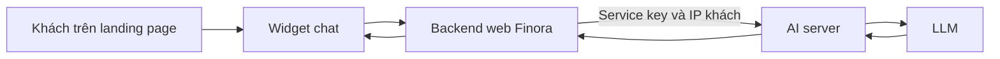

# Kết nối chatbot demo để hiển thị trên landing page Finora

## 1. Cần làm ở đâu?

AI server trong repository này đã có API demo. Để khách chưa đăng nhập thấy và sử dụng chatbot tại `https://finora.com.vn/`, cần thêm hai phần ở **repository website Finora**: API proxy trong backend web và widget chat trong giao diện landing page.



Browser chỉ gọi backend web. Backend web gắn service key rồi gọi AI server; không đưa service key, JWT signing secret hoặc LLM key vào frontend. Khách dùng demo không cần đăng nhập và không cần JWT tenant giả.

Các đường dẫn `/api/demo-chat/*` dưới đây là **route đề xuất tạo ở backend web**. Các đường dẫn `/api/chatbot/demo/*` là **route đã có ở AI server**:

| Browser gọi backend web | Backend web gọi AI server | Response thành công |
| --- | --- | --- |
| `GET /api/demo-chat/config` | `GET /api/chatbot/demo/config` | `{botName,welcome,suggestions,loginUrl,signupUrl}` |
| `POST /api/demo-chat/chat` | `POST /api/chatbot/demo/chat` | `{reply,mode:"demo"}` |

Ví dụ dùng Node.js + Express cho backend và JavaScript thuần cho widget. Đây là mẫu để đưa vào dự án web thực tế; thư mục `server/` và `client/` trong hướng dẫn không phải cấu trúc có sẵn của repository Python này. Nếu web dùng React/Vue hoặc framework Node khác, giữ nguyên contract và chuyển phần giao diện/router sang convention của web.

## 2. Bật API demo ở AI server

Triển khai phiên bản AI server có hai route demo, rồi bổ sung vào `.env` **của AI server**:

```dotenv
DEMO_ENABLED=true
DEMO_RATE_LIMIT_PER_MIN=15
DEMO_MODEL=
BRAND_NAME=Finora
WEBSITE_URL=https://finora.com.vn/
LOGIN_URL=https://finora.com.vn/signin
SIGNUP_URL=https://finora.com.vn/signup
FINORA_SERVICE_KEY=<service-key-server-to-server>
```

Giữ cấu hình provider và API key hiện có: Gemini hoặc FPT. `DEMO_MODEL` để trống sẽ chọn mặc định theo provider. Giữ cả cấu hình database/xác thực của ứng dụng chung theo [VPS_DEPLOYMENT.md](VPS_DEPLOYMENT.md); đoạn trên chỉ là phần liên quan đến demo, không thay thế toàn bộ `.env` production.

Restart AI server sau khi đổi biến môi trường hoặc cập nhật code. `ENABLE_DEMO=false` chỉ tắt UI tĩnh `/demo`; endpoint landing page được điều khiển riêng bởi `DEMO_ENABLED`.

Địa chỉ minh họa:

| Môi trường | AI server | Backend web | Frontend |
| --- | --- | --- | --- |
| Local | `http://127.0.0.1:8000` | `http://127.0.0.1:3000` | Vite, ví dụ `http://localhost:5173` |
| Production | `https://ai.finora.com.vn` hoặc URL triển khai thực tế | Được reverse proxy qua domain web | `https://finora.com.vn` |

Nếu dùng container, `127.0.0.1` trong container Node chỉ đến chính container đó. Đổi `AI_SERVER_URL` thành hostname service/IP có thể truy cập từ Node. Chỉ dùng HTTP cho local hoặc mạng nội bộ đã được cấu hình phù hợp.

## 3. Thêm API proxy vào backend web

### 3.1. Biến môi trường của backend web

Đặt trong `.env`/secret manager **của backend Node**, không đặt trong `.env` frontend:

```dotenv
# Local; production đổi thành URL AI server thực tế.
AI_SERVER_URL=http://127.0.0.1:8000
AI_SERVICE_KEY=<cung-gia-tri-voi-FINORA_SERVICE_KEY-o-AI-server>

# Local không qua proxy: để trống.
# Nếu Nginx cùng host proxy đến Node: có thể dùng loopback.
# Nếu qua proxy khác: điền IP/CIDR của đúng proxy đã kiểm soát.
TRUSTED_PROXY_CIDRS=
```

Không dùng prefix `VITE_` cho các biến này. Backend cần Node hỗ trợ native `fetch` và `AbortSignal.timeout`; ví dụ này có thể chạy bằng Node 22/24. Nếu đã có Express và cơ chế nạp `.env`, tái sử dụng chúng. Nếu chưa có, cài `express` và `dotenv` vào dự án backend bằng package manager đang dùng.

### 3.2. Router Express

Tạo file tương ứng, ví dụ `server/routes/demoChat.js`. Code dùng ES modules:

```js
import { Router, json } from "express";
import { randomUUID } from "node:crypto";
import { isIP } from "node:net";

export function createDemoChatRouter() {
  const origin = process.env.AI_SERVER_URL;
  const key = process.env.AI_SERVICE_KEY;
  if (!origin || !key) throw new Error("Thiếu cấu hình kết nối AI server.");
  const base = new URL(origin);
  if (!["http:", "https:"].includes(base.protocol)) {
    throw new Error("AI_SERVER_URL phải là URL HTTP/HTTPS.");
  }

  const router = Router();
  router.use((_req, res, next) => {
    res.setHeader("Cache-Control", "no-store");
    next();
  });
  router.use(json({ limit: "20kb", strict: true }));

  async function forward(req, res, path, body) {
    const requestId = randomUUID();
    res.setHeader("X-Request-ID", requestId);
    const ip = req.ip || req.socket.remoteAddress;
    if (!ip || !isIP(ip)) {
      return res.status(503).json({ error: "Chưa xác định được kết nối. Vui lòng thử lại." });
    }
    try {
      const upstream = await fetch(new URL(path, base), {
        method: body === undefined ? "GET" : "POST",
        headers: {
          "X-Finora-Service-Key": key,
          "X-Client-IP": ip, // BE xác định; không lấy từ header do browser gửi.
          "X-Request-ID": requestId,
          ...(body === undefined ? {} : { "Content-Type": "application/json" }),
        },
        body: body === undefined ? undefined : JSON.stringify(body),
        signal: AbortSignal.timeout(body === undefined ? 10000 : 90000),
      });
      let payload;
      try {
        payload = await upstream.json();
      } catch {
        return res.status(502).json({ error: "Dịch vụ chat chưa trả lời đúng định dạng. Vui lòng thử lại." });
      }
      if ([401, 403].includes(upstream.status)) {
        // Lỗi credential giữa hai server, không phải khách cần đăng nhập.
        return res.status(502).json({ error: "Kết nối trợ lý đang được cấu hình. Vui lòng thử lại sau." });
      }
      if (!upstream.ok) {
        const status = [400, 404, 429, 500, 503].includes(upstream.status)
          ? upstream.status : 502;
        if (status === 429) {
          const retry = upstream.headers.get("Retry-After") || "60";
          res.setHeader("Retry-After", /^\d+$/.test(retry) ? retry : "60");
        }
        return res.status(status).json({
          error: typeof payload?.error === "string"
            ? payload.error : "Trợ lý demo tạm thời chưa sẵn sàng.",
        });
      }
      if (body !== undefined) {
        if (payload?.mode !== "demo" || typeof payload.reply !== "string") {
          return res.status(502).json({ error: "Phản hồi chat chưa hợp lệ. Vui lòng thử lại." });
        }
        return res.json({ reply: payload.reply, mode: "demo" });
      }
      if (typeof payload?.botName !== "string" || typeof payload.welcome !== "string"
          || !Array.isArray(payload.suggestions)
          || !payload.suggestions.every((item) => typeof item === "string")
          || typeof payload.loginUrl !== "string" || typeof payload.signupUrl !== "string") {
        return res.status(502).json({ error: "Chưa tải được cấu hình trợ lý." });
      }
      return res.json({
        botName: payload.botName, welcome: payload.welcome,
        suggestions: payload.suggestions,
        loginUrl: payload.loginUrl, signupUrl: payload.signupUrl,
      });
    } catch (error) {
      const timeout = error?.name === "TimeoutError" || error?.name === "AbortError";
      return res.status(timeout ? 504 : 503).json({
        error: timeout ? "Trợ lý trả lời lâu hơn dự kiến. Bạn vui lòng thử lại."
          : "Chưa kết nối được trợ lý. Bạn vui lòng thử lại sau.",
      });
    }
  }

  router.get("/config", (req, res) => forward(req, res, "/api/chatbot/demo/config"));
  router.post("/chat", (req, res) => {
    if (!req.is("application/json") || !Array.isArray(req.body?.messages)) {
      return res.status(400).json({ error: "Hội thoại phải có mảng messages trong JSON." });
    }
    // Chỉ chuyển hội thoại; không chuyển cookies, Authorization, tenant hay shop.
    return forward(req, res, "/api/chatbot/demo/chat", { messages: req.body.messages });
  });
  router.use((error, _req, res, next) => {
    if (["entity.too.large", "entity.parse.failed"].includes(error?.type)) {
      return res.status(400).json({ error: "JSON không hợp lệ hoặc hội thoại vượt quá 20 KB." });
    }
    next(error);
  });
  return router;
}
```

AI server kiểm tra role, độ dài và lịch sử. Backend web không tự tạo system prompt, dữ liệu mẫu hoặc câu trả lời dự phòng có số liệu. Nếu web có middleware tự bọc response, giữ contract demo ở trên hoặc sửa widget tương ứng.

### 3.3. Mount router ngoài vùng bắt buộc đăng nhập

Trong entry point backend Express hiện tại, thêm import và mount **trước middleware yêu cầu đăng nhập và trước JSON parser dùng giới hạn lớn hơn**. Giữ các route/middleware khác của web:

```js
import "dotenv/config";
import express from "express";
import { createDemoChatRouter } from "./routes/demoChat.js";

const app = express(); // Trong app có sẵn, dùng instance Express hiện tại.
const trusted = (process.env.TRUSTED_PROXY_CIDRS || "")
  .split(",").map((value) => value.trim()).filter(Boolean);
app.set("trust proxy", trusted.length ? trusted : false);

app.use("/api/demo-chat", createDemoChatRouter());

// Middleware login/auth và các router cần đăng nhập đặt phía sau.
// Giữ body parser/error handler của hệ thống theo convention hiện có.
app.listen(3000, "127.0.0.1"); // Hoặc listener/port hiện có của backend.
```

Nếu app đã được tạo, chỉ chèn phần cấu hình/mount; không tạo app hoặc listener thứ hai. Với Docker, dùng bind address theo cấu hình mạng container của web.

`req.ip` chỉ phản ánh IP khách chính xác khi `trust proxy` khớp hạ tầng. Proxy cuối do bạn kiểm soát phải ghi đè header IP từ bên ngoài; không đặt `trust proxy=true` theo mặc định. Xem [Express: behind proxies](https://expressjs.com/en/guide/behind-proxies/). Giới hạn/parser JSON trong ví dụ theo [Express: body-parser](https://expressjs.com/en/resources/middleware/body-parser/); timeout dùng [Node.js AbortSignal](https://nodejs.org/api/globals.html#static-method-abortsignaltimeoutdelay).

## 4. Thêm widget vào landing page

Widget cần có nút mở chat, lời chào từ config, nhãn dữ liệu mẫu, các câu gợi ý, vùng hội thoại, ô nhập và link đăng ký/đăng nhập. Đọc `reply` trực tiếp từ JSON; không đọc `data.answer` của API chat đã đăng nhập.

### 4.1. HTML

Đưa block này vào template landing page. Đặt ID chỉ một lần trên trang:

```html
<div id="finora-demo">
  <button data-toggle type="button" aria-expanded="false"
          aria-controls="finora-chat-panel">Chat với Finora</button>
  <section id="finora-chat-panel" data-panel hidden aria-label="Chatbot Finora">
    <header><strong data-name>Trợ lý Finora</strong><small>Demo — dữ liệu mẫu</small></header>
    <div data-log role="log" aria-live="polite"></div>
    <div data-suggestions></div>
    <p data-status role="status"></p>
    <button data-reload type="button" hidden>Thử tải lại</button>
    <form data-form>
      <input data-input aria-label="Tin nhắn" maxlength="500"
             placeholder="Hỏi về doanh thu, quảng cáo..." required disabled />
      <button data-send type="submit" disabled>Gửi</button>
    </form>
    <footer><a data-signup href="/signup">Đăng ký xem dữ liệu thật</a>
      · <a data-login href="/signin">Đăng nhập</a></footer>
  </section>
</div>
```

### 4.2. CSS tối thiểu

Ghép vào stylesheet của web, điều chỉnh màu/font theo thiết kế Finora:

```css
#finora-demo { position: fixed; right: 16px; bottom: 16px; z-index: 1000; font: 14px/1.5 sans-serif; }
#finora-demo [hidden] { display: none !important; }
#finora-demo button, #finora-demo input { font: inherit; }
#finora-demo button { cursor: pointer; padding: 8px 12px; border: 1px solid #d1d5db; border-radius: 8px; }
#finora-demo button:disabled { cursor: wait; opacity: .55; }
#finora-demo [data-toggle] { float: right; background: #0f766e; color: white; }
#finora-demo [data-panel] { clear: both; width: min(360px, calc(100vw - 32px)); max-height: calc(100dvh - 96px); overflow-y: auto; background: white; border: 1px solid #ddd; border-radius: 12px; box-shadow: 0 8px 32px #0002; }
#finora-demo header, #finora-demo footer { padding: 12px; background: #f0fdfa; }
#finora-demo small { display: block; color: #475569; }
#finora-demo [data-log] { height: min(300px, 38dvh); overflow-y: auto; padding: 12px; }
#finora-demo .bubble { white-space: pre-wrap; overflow-wrap: anywhere; padding: 8px 10px; border-radius: 8px; background: #f1f5f9; margin: 0 0 8px; }
#finora-demo .bubble.user { background: #ccfbf1; margin-left: 24px; }
#finora-demo [data-suggestions] { display: flex; gap: 6px; flex-wrap: wrap; padding: 0 12px; }
#finora-demo [data-status] { padding: 0 12px; color: #475569; }
#finora-demo form { display: flex; gap: 6px; padding: 12px; }
#finora-demo input { min-width: 0; flex: 1; border: 1px solid #cbd5e1; border-radius: 8px; padding: 8px; }
```

### 4.3. JavaScript gọi API và quản lý lịch sử

Tạo module ở frontend, ví dụ `client/src/demo-chat.js`:

```js
export function mountDemoChat(root) {
  const $ = (selector) => root.querySelector(selector);
  const lifetime = new AbortController();
  const on = (element, event, handler) =>
    element.addEventListener(event, handler, { signal: lifetime.signal });
  const panel = $("[data-panel]"), toggle = $("[data-toggle]");
  const input = $("[data-input]"), sendButton = $("[data-send]");
  const status = $("[data-status]"), log = $("[data-log]");
  const suggestions = $("[data-suggestions]"), reload = $("[data-reload]");
  let config = null, history = [], busy = false, cooldown = false;
  let activeRequest = null, cooldownTimer = null;

  function controls() {
    const disabled = !config || busy || cooldown;
    input.disabled = disabled;
    sendButton.disabled = disabled;
    suggestions.querySelectorAll("button").forEach((button) => { button.disabled = disabled; });
  }
  function bubble(role, text) {
    const element = document.createElement("p");
    element.className = `bubble ${role}`;
    element.textContent = text; // Không render câu trả lời LLM bằng innerHTML.
    log.append(element);
    log.scrollTop = log.scrollHeight;
    return element;
  }
  function recent(messages) {
    const result = messages.slice(-10);
    while (result.length && result[0].role !== "user") result.shift();
    return result.map((message) => ({
      role: message.role,
      content: message.role === "assistant"
        ? Array.from(message.content).slice(0, 2000).join("") : message.content,
    }));
  }
  async function request(path, body) {
    const controller = new AbortController();
    activeRequest = controller;
    const timer = setTimeout(() => controller.abort(), 100000);
    try {
      const response = await fetch(`/api/demo-chat/${path}`, {
        method: body === undefined ? "GET" : "POST",
        headers: body === undefined ? {} : { "Content-Type": "application/json" },
        body: body === undefined ? undefined : JSON.stringify(body),
        signal: controller.signal,
      });
      let data;
      try { data = await response.json(); }
      catch { throw new Error("Chưa nhận được phản hồi chat hợp lệ."); }
      if (!response.ok) {
        const error = new Error(typeof data.error === "string" ? data.error : "Chưa kết nối được trợ lý.");
        error.status = response.status;
        error.retryAfter = Number(response.headers.get("Retry-After")) || 60;
        throw error;
      }
      return data;
    } finally {
      clearTimeout(timer);
      activeRequest = null;
    }
  }
  async function loadConfig() {
    reload.hidden = true;
    status.textContent = "Đang tải trợ lý...";
    try {
      config = await request("config");
      if (lifetime.signal.aborted) return;
      $("[data-name]").textContent = config.botName;
      $("[data-signup]").href = config.signupUrl;
      $("[data-login]").href = config.loginUrl;
      bubble("assistant", config.welcome); // Chỉ hiển thị; không thêm lời chào vào history.
      suggestions.replaceChildren();
      for (const text of config.suggestions) {
        const button = document.createElement("button");
        button.type = "button";
        button.textContent = text;
        on(button, "click", () => send(text));
        suggestions.append(button);
      }
      status.textContent = "";
    } catch (error) {
      if (!lifetime.signal.aborted) {
        config = null;
        status.textContent = error.message;
        reload.hidden = false;
      }
    } finally { controls(); }
  }
  async function send(value) {
    if (!config || busy || cooldown) return;
    const text = value.trim();
    if (!text || Array.from(text).length > 500) {
      status.textContent = "Bạn nhập từ 1 đến 500 ký tự nhé.";
      return;
    }
    const outgoing = recent([...history, { role: "user", content: text }]);
    if (new TextEncoder().encode(JSON.stringify({ messages: outgoing })).length > 20 * 1024) {
      status.textContent = "Hội thoại quá dài. Bạn vui lòng tải lại trang để bắt đầu cuộc chat mới.";
      return;
    }
    const pendingBubble = bubble("user", text);
    input.value = "";
    busy = true;
    controls();
    status.textContent = "Trợ lý đang trả lời...";
    try {
      const data = await request("chat", { messages: outgoing });
      if (lifetime.signal.aborted) return;
      if (data.mode !== "demo" || typeof data.reply !== "string") {
        throw new Error("Phản hồi chat chưa hợp lệ.");
      }
      bubble("assistant", data.reply);
      history = [...outgoing, { role: "assistant", content: data.reply }];
      status.textContent = "";
    } catch (error) {
      if (lifetime.signal.aborted) return;
      pendingBubble.remove(); // Tin lỗi không được lưu thành một lượt hội thoại thành công.
      input.value = text;
      status.textContent = error.name === "AbortError"
        ? "Trợ lý trả lời lâu hơn dự kiến. Bạn vui lòng thử lại." : error.message;
      if (error.status === 429) {
        cooldown = true;
        cooldownTimer = setTimeout(() => {
          cooldown = false;
          status.textContent = "Bạn có thể gửi lại tin nhắn.";
          controls();
        }, Math.min(300, Math.max(1, error.retryAfter)) * 1000);
      }
    } finally {
      busy = false;
      controls();
      if (!input.disabled && !panel.hidden) input.focus();
    }
  }
  on(toggle, "click", () => {
    panel.hidden = !panel.hidden;
    toggle.setAttribute("aria-expanded", String(!panel.hidden));
    if (!panel.hidden && !input.disabled) input.focus();
  });
  on($("[data-form]"), "submit", (event) => { event.preventDefault(); send(input.value); });
  on(reload, "click", loadConfig);
  loadConfig();
  return () => {
    lifetime.abort();
    activeRequest?.abort();
    clearTimeout(cooldownTimer);
  };
}
```

Trong entry JavaScript của landing page, gọi sau khi block HTML đã được mount:

```js
import { mountDemoChat } from "./demo-chat.js";

const root = document.querySelector("#finora-demo");
if (root) {
  const unmountChat = mountDemoChat(root);
  // Với SPA, gọi unmountChat() khi rời/unmount landing page.
}
```

Trong React dùng lifecycle của component để mount/cleanup; trong Vue dùng `onMounted`/`onUnmounted`. Đặt widget ở layout landing page hoặc component đã có, tránh mount lại mỗi lần render. Với trang HTML độc lập, tải module bằng script `type="module"` sau block HTML.

Code trên hiển thị văn bản thuần, vì vậy dấu `**` có thể vẫn xuất hiện trong câu trả lời. Nếu web muốn render Markdown, dùng renderer có sanitizer đang được dự án chấp thuận; không đưa trực tiếp câu trả lời vào `innerHTML`/`dangerouslySetInnerHTML`.

## 5. Cho frontend gọi được backend

### Local với Vite

Ghép proxy sau vào `server` trong `vite.config.js`/`vite.config.ts`, giữ plugins và cấu hình hiện có:

```js
import { defineConfig } from "vite";

export default defineConfig({
  server: {
    proxy: {
      "/api/demo-chat": { target: "http://127.0.0.1:3000", changeOrigin: true },
    },
  },
});
```

Widget vẫn dùng URL tương đối `/api/demo-chat/...`; Vite chuyển request sang Node. Proxy này dành cho development; production cần routing/reverse proxy riêng. Tham khảo [Vite server.proxy](https://vite.dev/config/server-options#server-proxy).

### Production cùng domain landing page

Nếu `https://finora.com.vn/api/*` đã chuyển đến backend web, tái sử dụng routing đó. Nếu chưa có, thêm location tương ứng vào **Nginx của website**, trong server HTTPS hiện có; thay host/port Node theo hạ tầng:

```nginx
location /api/demo-chat/ {
    proxy_pass http://127.0.0.1:3000;
    proxy_set_header Host $host;
    # Ví dụ Nginx là điểm vào công khai trực tiếp: ghi đè header do client tự gửi.
    proxy_set_header X-Forwarded-For $remote_addr;
    proxy_set_header X-Forwarded-Proto $scheme;
    proxy_read_timeout 100s;
}
```

Trong trường hợp Nginx cùng host, backend đặt `TRUSTED_PROXY_CIDRS=loopback` và bind Node nội bộ. Nếu trước Nginx còn CDN/load balancer, cấu hình IP thật tại proxy theo đúng chuỗi tin cậy trước; không lấy `$remote_addr` của CDN làm IP khách. Sau khi cấu hình, xác nhận hai IP khách khác nhau không cùng chia một bucket rate limit.

Đây là cấu hình **website -> backend Node**, khác `deploy/nginx-finora.conf` là cấu hình phía AI server. Không proxy browser thẳng vào AI server hoặc chèn service key vào mã JavaScript. Với cách gọi cùng origin này, không cần mở CORS ở AI server cho browser.

Phía AI server hiện có Nginx limit chung theo IP kết nối. Nếu mọi request đến từ một BE, chúng có thể bị gộp quota. Xem phần rate limit và ví dụ IP tin cậy trong [DEMO_CHATBOT.md](DEMO_CHATBOT.md) và [deploy/nginx-finora.conf](../deploy/nginx-finora.conf) trước khi chạy nhiều người dùng/worker.

## 6. Kiểm tra kết nối theo từng chặng

### 6.1. Từ máy backend web đến AI server

Ví dụ Bash, đọc service key từ biến môi trường của backend; không gõ key thật vào command/history:

```bash
curl -i "$AI_SERVER_URL/api/chatbot/demo/config" \
  -H "X-Finora-Service-Key: $AI_SERVICE_KEY"
```

Kỳ vọng `200`, có `botName`, lời chào nêu rõ dữ liệu mẫu và hai URL `/signin`, `/signup`. Có thể kiểm tra config mà chưa phát sinh token LLM. POST chat ở các bước sau sẽ gọi model đã cấu hình.

### 6.2. Từ browser/curl đến backend web

Các lệnh sau không cần service key hoặc JWT vì đi vào route public của web:

```bash
curl -i http://127.0.0.1:3000/api/demo-chat/config

curl -i http://127.0.0.1:3000/api/demo-chat/chat \
  -H 'Content-Type: application/json' \
  --data '{"messages":[{"role":"user","content":"Doanh thu hôm qua bao nhiêu?"}]}'
```

Trên Windows, dùng `curl.exe`. Với payload tiếng Việt, lưu UTF-8 thành `payload.json` rồi gửi:

```powershell
curl.exe -i http://127.0.0.1:3000/api/demo-chat/chat -H "Content-Type: application/json" --data-binary "@payload.json"
```

Kỳ vọng dạng response (cách diễn đạt do LLM quyết định):

```json
{"reply":"Doanh thu hôm qua là 24,1 triệu đồng...","mode":"demo"}
```

### 6.3. Kiểm tra landing page

1. Mở trang ở chế độ chưa đăng nhập, bấm “Chat với Finora”.
2. Thấy lời chào, nhãn dữ liệu mẫu, sáu gợi ý và link đăng ký/đăng nhập.
3. Hỏi doanh thu hôm qua: model cần dựa vào số mẫu 24,1 triệu; thử một câu hỏi tiếp nối để kiểm tra history.
4. Hỏi lợi nhuận 6,4%, cách đăng ký và đăng nhập; thử câu kiến thức vận hành không có trong tài liệu để kiểm tra fallback LLM.
5. Thử lỗi mạng và `429`: giao diện hiển thị lỗi, giữ câu vừa nhập, không tự gửi lại hoặc tạo hai lượt chat đồng thời.
6. Trong DevTools -> Network, browser chỉ gọi `/api/demo-chat/*` ở domain web, không gọi AI server/provider và không có service key trong request hay bundle.
7. Kiểm tra mobile: nút mở/đóng, vùng cuộn và ô nhập không bị che; CTA mở đúng `https://finora.com.vn/signup` và `/signin`.

## 7. Lỗi thường gặp

| Hiện tượng | Nguyên nhân cần kiểm tra |
| --- | --- |
| Web trả `404` | Chưa mount router web, chưa cấu hình proxy hoặc API demo AI đang tắt/chưa deploy bản mới |
| Browser bị yêu cầu đăng nhập | Router public bị đặt sau auth middleware; demo không dùng helper ký JWT của chat tenant |
| AI server trả `401`, web trả `502` theo mẫu | `AI_SERVICE_KEY` không khớp `FINORA_SERVICE_KEY`, hoặc proxy làm mất header |
| Config `200`, chat `503` | Provider/API key/model demo chưa sẵn sàng, lỗi kết nối hoặc upstream quá tải |
| Chat `504` từ Node/proxy | Kiểm tra timeout giữa các chặng; AI có thể thử hai attempt, không đặt timeout proxy 10–30 giây |
| Frontend gửi xong nhưng không hiện câu trả lời | Đang đọc `data.answer` thay vì `reply`, hoặc middleware web tự bọc envelope |
| Chat lượt đầu bị `400` | Đưa lời chào assistant vào đầu history; chỉ lời chào UI được hiển thị, request đầu phải là user |
| Chat lâu bị `400` | Quên cắt history, tin user hơn 500 ký tự, assistant history quá dài hoặc body hơn 20 KiB |
| Nhiều khách cùng bị `429` | IP thật chưa được BE/proxy xác định, hoặc Nginx phía AI gộp mọi người theo IP backend |
| Lỗi CORS hoặc frontend nhận HTML | URL frontend/proxy sai hoặc request bị SPA fallback; kiểm tra response `Content-Type` và proxy `/api/demo-chat` |
| Local chạy nhưng production lỗi | Vite proxy chỉ phục vụ dev; production chưa route `/api/demo-chat/*` đến Node |

AI server giới hạn mặc định 15 POST/phút/IP trong mỗi process. BE nên tái sử dụng cơ chế rate limit public hiện có; nhiều worker/instance cần quota chung ở gateway/Nginx phù hợp. Các lỗi web `502`/`504` trong ví dụ là lỗi trung gian; AI demo trực tiếp dùng `400/401/404/429/500/503`. Không biến lỗi xác thực service thành yêu cầu khách đăng nhập.

## 8. Danh sách bàn giao cho đội web

- Backend: cấu hình `AI_SERVER_URL`, `AI_SERVICE_KEY`, proxy tin cậy; mount GET config/POST chat ngoài auth; chuyển IP đã xác minh, giữ response và mã lỗi.
- Frontend: mount widget ở landing page, gọi config/chat qua backend, giữ history trong bộ nhớ tab, hiển thị dữ liệu mẫu và CTA đăng ký/đăng nhập.
- Hạ tầng: deploy AI server có route mới; restart sau thay đổi env; kiểm tra domain/proxy/timeout và rate limit theo IP thật.
- Nghiệm thu: kiểm tra cả ba chặng ở mục 6 và chất lượng câu trả lời với provider thật. Ví dụ trong tài liệu chưa được cài vào repository website vì repository đó không nằm trong workspace này.

Chi tiết contract, dataset, các biến demo và giới hạn cách ly xem [DEMO_CHATBOT.md](DEMO_CHATBOT.md). Chat dữ liệu thật sau đăng nhập tiếp tục dùng contract tại [WEB_INTEGRATION.md](WEB_INTEGRATION.md).
